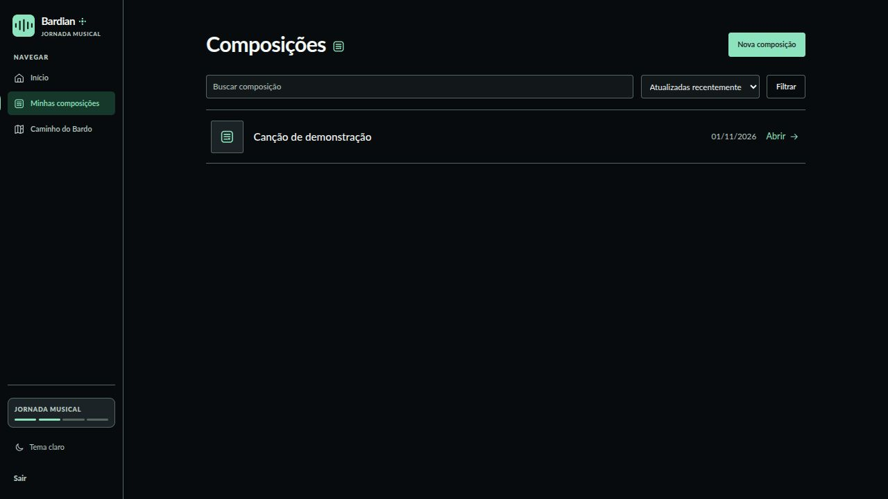
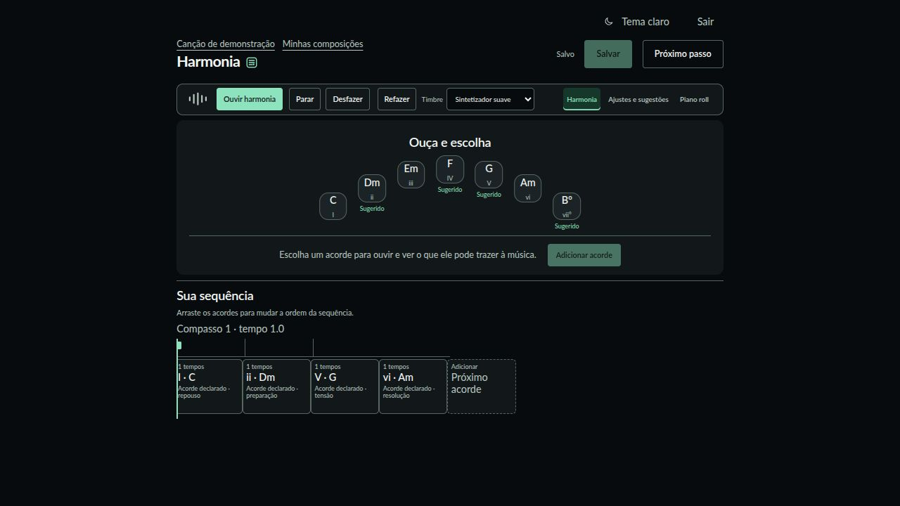
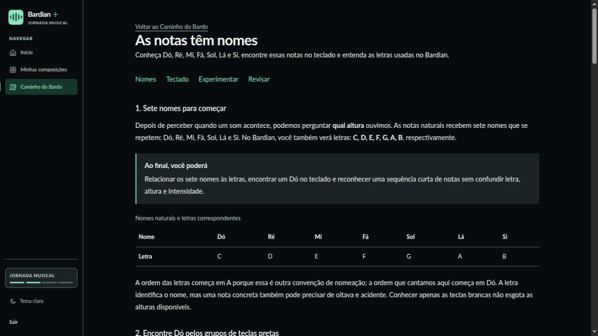

# Bardian

O Bardian é uma aplicação de criação e aprendizagem musical voltada a pessoas
que estão começando a compor. A proposta é experimentar uma ideia, ouvir o
resultado e compreender as relações musicais envolvidas no mesmo ambiente.
Este repositório faz parte de um Trabalho de Conclusão de Curso (TCC).

## O que já é possível fazer

- **Gerenciar composições:** criar uma música com nome e capa opcional, buscar,
  ordenar, abrir, renomear e excluir as próprias composições. O acesso à
  biblioteca exige uma conta.
- **Começar pelos primeiros sons:** escolher andamento, tônica, modo e timbre;
  ouvir propostas de quatro acordes e decidir se alguma delas inicia a música.
  Também é possível começar com a harmonia vazia.
- **Escrever harmonia:** ouvir os sete acordes do campo harmônico, montar e
  reorganizar uma sequência, ajustar a duração dos acordes, editar notas no
  piano roll, desfazer/refazer e salvar. A interface apresenta sugestões e
  explicações simples de função harmônica sem aplicar mudanças automaticamente.
- **Ouvir a composição:** reproduzir a harmonia salva e trocar entre os timbres
  disponíveis. A reprodução usa eventos musicais do documento da composição.
- **Aprender no Caminho do Bardo:** acessar sete aulas publicadas sobre pulsação,
  ritmo e pausas, compassos, escuta, nomes das notas, oitavas e construção de
  uma primeira ideia musical. As aulas incluem exemplos sonoros; quem possui
  conta pode marcar a conclusão.

## Representação musical

O núcleo distingue a **grafia musical** da **altura MIDI**. `Note`, `Interval`,
`Scale` e `Chord` representam notas, relações intervalares, escalas e acordes.
O contexto tonal declarado (tônica e modo maior ou menor natural) permite
derivar sete tríades, seus graus e funções didáticas simplificadas.

Cada composição salva contém andamento, fórmula de compasso, faixas, regiões
MIDI e eventos de nota com posição, duração, altura e intensidade. A harmonia
também registra blocos de acordes em ordem temporal. O editor, a assistência
e a reprodução trabalham a partir dessa estrutura; as sugestões são projeções
temporárias e só entram na composição por uma ação explícita da pessoa.
Consulte [convenções do domínio](docs/dominio-musical.md) e
[contrato musical do MVP](docs/contrato-musical-mvp1.md) para os detalhes.

## Páginas em funcionamento

| Página | Endereço | O que oferece |
| --- | --- | --- |
| Biblioteca de composições | `/compositions` | Lista, busca, criação e acesso às músicas da conta. |
| Primeiros sons | `/compositions/:id/setup` | Configuração inicial e prévias de harmonia para uma composição nova. |
| Editor de harmonia | `/compositions/:id/harmony` | Acordes, sequência, sugestões, piano roll, reprodução e salvamento. |
| Caminho do Bardo | `/caminho-do-bardo` | Mapa das aulas publicadas e acesso aos conteúdos. |
| Aula publicada | `/caminho-do-bardo/:slug` | Texto, exemplos para ouvir e conclusão individual. |

As telas abaixo foram capturadas da aplicação em execução, com uma composição
de demonstração no ambiente de teste.

### Biblioteca de composições



### Editor de harmonia



### Aula “As notas têm nomes”



## Próximas melhorias

Estas frentes estão planejadas; ainda não são recursos entregues:

- ornamentar harmonias com assistência contextual, preservando a escolha da
  pessoa sobre cada sugestão;
- ampliar as aulas com ornamentação, arpejos, formação de acordes e outros
  conceitos de harmonia;
- evoluir a edição de arranjos e a manipulação das faixas da composição.

Exportação de áudio, mixer e análise de arquivos de áudio também não fazem
parte do fluxo atual. A análise de áudio permanece um estudo experimental.

## Executar localmente

O projeto usa Ruby on Rails, SQLite e Node 22. Para preparar o banco, as
dependências do motor de áudio e iniciar a aplicação:

```bash
mise exec -- bundle install
mise exec -- bin/rails db:prepare
npm ci --ignore-scripts
node bin/setup-soundfonts
npm run build:audio
mise exec -- bin/rails server
```

Acesse `http://localhost:3000`, crie uma conta e abra **Minhas composições**.
O áudio no navegador requer AudioWorklet, WebAssembly e isolamento de origem;
em produção, use HTTPS. O build gera `public/audio-engine`, que não é
versionado. O banco de timbres FluidR3 é instalado localmente e validado antes
do uso; o primeiro carregamento de um timbre pode exigir download no navegador.
Veja [integração de áudio e limites](docs/harmonia-opendaw.md).

### Autenticação e configuração opcional

O cadastro por e-mail e senha funciona sem Google. Para habilitar o login com
Google, configure `GOOGLE_CLIENT_ID` e `GOOGLE_CLIENT_SECRET` no ambiente. No
cliente OAuth Web, cadastre a URI
`http://localhost:3000/users/auth/google_oauth2/callback` para desenvolvimento
ou a URI HTTPS equivalente do domínio final. Uma conta criada por senha só é
associada ao Google quando a pessoa entra com a senha e escolhe **Vincular
Google** no menu da conta.

Para criar o administrador local via seed, copie `.env.example` para `.env`,
preencha `ADMIN_EMAIL` e `ADMIN_PASSWORD` e execute
`mise exec -- bin/rails db:seed`. Não versione o `.env` real.

### Verificação

```bash
PARALLEL_WORKERS=1 mise exec -- bin/rails test
node --test test/javascript/*.mjs
mise exec -- bin/rubocop
npm run build:audio
```

O CI também constrói a imagem Docker. Antes de publicar, ainda é necessário
configurar domínio HTTPS, segredos, callback OAuth, volume persistente para
SQLite e Active Storage e backup desse volume. `config/deploy.yml` contém
endereços de exemplo e precisa ser ajustado para um ambiente real.

## Documentação do projeto

- [Convenções do domínio musical](docs/dominio-musical.md)
- [Contrato musical do MVP 1](docs/contrato-musical-mvp1.md)
- [Persistência de composições](docs/persistencia-composicoes-mvp1.md)
- [Timeline de composições](docs/timeline-composicoes-mvp1.md)
- [Integração de áudio e harmonia](docs/harmonia-opendaw.md)

As entregas verificadas do TCC são registradas em `config/dev_reports.yml`.
Páginas e experimentos antigos preservados em `app/legacy/` e `docs/legacy/`
servem apenas como referência acadêmica.
